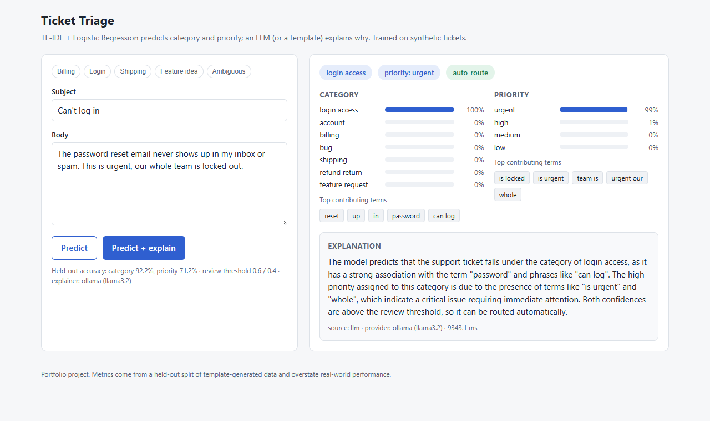
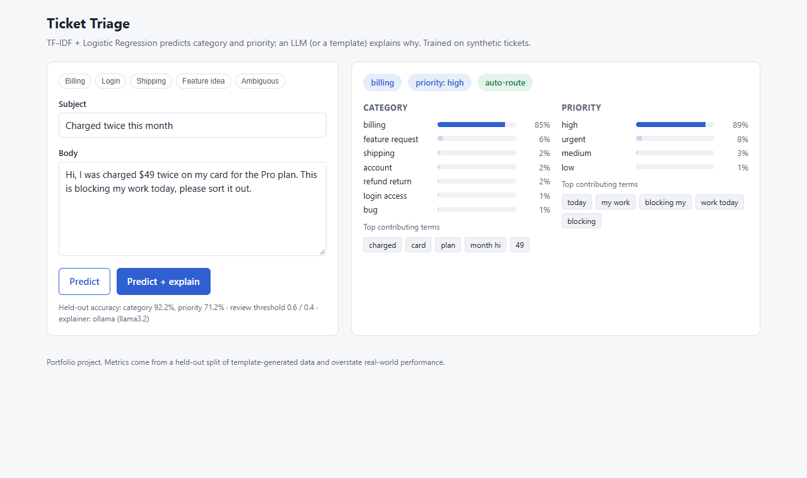
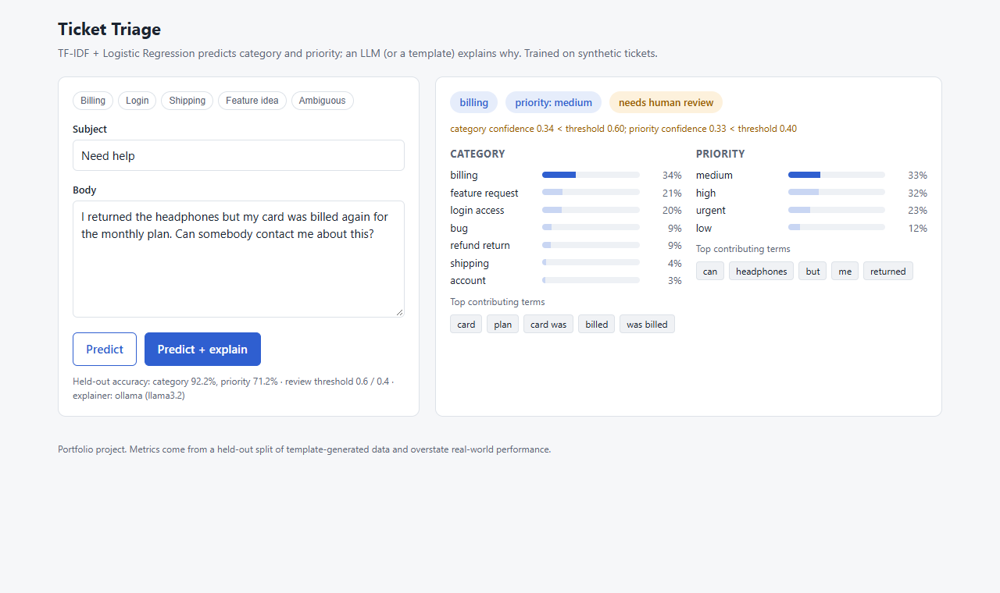
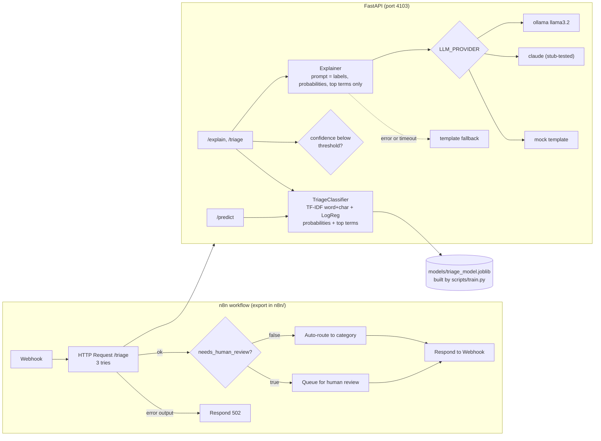

# Ticket Triage ML Service

A FastAPI service that classifies support tickets by category and priority with scikit-learn, explains each prediction in plain English with a local LLM, and plugs into n8n.

[](https://github.com/sahil-ambekarr/ticket-triage-ml-service/actions/workflows/ci.yml)
[](LICENSE)




| Auto-routed prediction | Low-confidence ticket sent to review |
|---|---|
|  |  |

Screenshots are real Playwright captures of the demo page at `/`, running locally with `LLM_PROVIDER=ollama` (llama3.2).

> **The training data is synthetic.** All 3,000 tickets are template-generated by `scripts/generate_dataset.py`. The test set comes from the same templates, so every metric in this repo overstates how the model would do on real tickets. This is a portfolio project, not a production system.

## The problem it automates

A support inbox has to sort each ticket into a queue and decide how urgent it is before anyone can work on it. A text classifier can do the obvious cases in milliseconds, but agents don't trust a bare label, and a wrong label on an urgent ticket is costly. This service:

1. predicts category and priority with a fast, inspectable linear model,
2. shows the terms that drove each prediction and turns them into a short explanation,
3. sends low-confidence tickets to a human instead of guessing,
4. exposes one `/triage` call that an automation tool (n8n here) can use to route tickets.

## Architecture



## Features

- Category (7 classes) and priority (4 classes) prediction with full probability distributions.
- Top contributing terms per prediction (tf-idf value times class coefficient, word features only).
- `needs_human_review` when category confidence < 0.6 or priority confidence < 0.4, with the reasons listed.
- Explanations from Ollama (default), Claude or a deterministic template. The prompt holds only the model's evidence, never the ticket text. Any LLM error or timeout falls back to the template; the review sentence is always written by code.
- Seeded synthetic dataset generator with typos, ambiguous and vague tickets and label noise.
- Training script comparing Logistic Regression, LinearSVC and Complement NB with 5-fold CV, held-out metrics, confusion-matrix PNGs and a threshold coverage table.
- Importable n8n workflow with retries, an IF branch on review and an error branch.
- Demo page at `/`, OpenAPI docs at `/docs`, JSON-line logs.

## Tech stack

Python 3.14, scikit-learn 1.9, FastAPI, Pydantic 2, httpx, Anthropic Python SDK 2.x, Ollama (llama3.2 3B), n8n, pytest, ruff, Playwright (screenshots), GitHub Actions.

## Quick start

Needs Python 3.12+ (built and tested on 3.14.5). Ollama is optional; use `LLM_PROVIDER=mock` without it.

Windows (PowerShell):

```powershell
py -3.14 -m venv .venv
.venv\Scripts\Activate.ps1
pip install -r requirements-dev.txt
python -m scripts.train            # about 80 s on a laptop CPU; writes models/ and reports/
$env:LLM_PROVIDER = "mock"         # or leave unset to use Ollama at localhost:11434
uvicorn app.main:app --port 4103
```

macOS / Linux:

```bash
python3 -m venv .venv && source .venv/bin/activate
pip install -r requirements-dev.txt
python -m scripts.train
LLM_PROVIDER=mock uvicorn app.main:app --port 4103
```

Then open http://localhost:4103/ or call the API:

```bash
curl -s -X POST http://localhost:4103/triage -H "Content-Type: application/json" \
  -d '{"subject":"Charged twice","body":"I was charged $49 twice on my card. This is blocking my work today."}'
```

For Ollama explanations: `ollama pull llama3.2`, then start the service without `LLM_PROVIDER=mock`.

Docker (not verified locally, there is no Docker on the build machine): `docker compose up --build`, then `docker compose exec ollama ollama pull llama3.2`. The compose file starts the API, Ollama and n8n (http://localhost:5678).

n8n: import `n8n/ticket-triage-workflow.json` (Workflows > Import from file). The HTTP node points at `http://api:4103/triage` (the compose service name); change the URL if n8n runs elsewhere. **This workflow has not been imported into a running n8n instance.** Its structure is checked by `tests/test_n8n_workflow.py`, which proves the JSON is well formed and wired as intended, not that n8n accepts every parameter.

## Configuration

Copy `.env.example` to `.env` or set environment variables.

| variable | default | meaning |
|---|---|---|
| `LLM_PROVIDER` | `ollama` | `ollama`, `claude` or `mock` |
| `OLLAMA_BASE_URL` | `http://localhost:11434` | Ollama server |
| `OLLAMA_MODEL` | `llama3.2` | Ollama model tag |
| `ANTHROPIC_API_KEY` | empty | required only for `claude` |
| `CLAUDE_MODEL` | `claude-haiku-5-5` | Claude model id |
| `LLM_TIMEOUT_SECONDS` | `60` | per-call timeout before the template fallback |
| `LLM_MAX_RETRIES` | `1` | retries with exponential backoff before falling back |
| `CONFIDENCE_THRESHOLD` | `0.6` | category confidence below this goes to review |
| `PRIORITY_CONFIDENCE_THRESHOLD` | `0.4` | priority confidence below this goes to review |
| `MODEL_PATH` | `models/triage_model.joblib` | trained bundle |
| `METRICS_PATH` | `reports/metrics.json` | shown by `/model-info` |
| `LOG_LEVEL` | `INFO` | log level |

Providers:

- **ollama**: local, free, slow on CPU (about 10 s per explanation here). Default.
- **claude**: Anthropic Messages API through the official SDK. Unit-tested with a stubbed HTTP layer only; **not verified against the live API** (no key on the build machine).
- **mock**: no LLM. Returns the template built from the top terms. Used by tests and CI.

## Eval results

All numbers below were measured on 2026-11-17 on a CPU-only laptop (AMD integrated graphics, 16 GB RAM, Windows 11), Python 3.14.5, scikit-learn 1.9.1. Ollama was shared with other jobs during the runs.

### Classifier (held-out test, 600 tickets)

| target | served model | accuracy | macro-F1 | best alternative |
|---|---|---|---|---|
| category | Logistic Regression | 0.922 | 0.917 | LinearSVC 0.927 / 0.922 |
| priority | Logistic Regression | 0.712 | 0.693 | LinearSVC 0.732 / 0.715 |

5-fold CV on the training split puts all three models within about one standard deviation on category (0.925 to 0.928 accuracy). With the default thresholds, 69 of 600 test tickets (11.5%) are flagged for review; category accuracy is 0.945 on the auto-routed rest and 0.739 on the flagged ones. Per-class tables and the reasoning for serving Logistic Regression are in [docs/MODEL_CARD.md](docs/MODEL_CARD.md).

Method: stratified 80/20 split, seed 42; TF-IDF word 1-2 grams + char_wb 3-5 grams. Reproduce with `python -m scripts.train` (about 80 s); output in `reports/metrics.json` and `reports/confusion_*.png`.

### Explanation layer (llama3.2 via Ollama, 12 held-out tickets)

| prompt version | mean latency | p95 latency | names category | quotes a top term | LLM text talks about review | fallbacks |
|---|---|---|---|---|---|---|
| v1: LLM also states the review decision | 15.8 s | 19.0 s | 12/12 | 12/12 | 4/12 contradicted the flag | 0 |
| v2 (current): review sentence appended by code | 10.7 s | 11.9 s | 12/12 | 12/12 | 0/12 | 0 |

Method: `python -m scripts.eval_explain --n 12` runs the classifier and the explainer directly (no HTTP), sequentially, temperature 0, no retries, one warm-up call excluded (v2 warm-up: 11.4 s). v2 sampled 4 tickets flagged for review plus 8 confident ones across categories; v1 sampled 12 confident ones. "Names category" is a case-insensitive match of the predicted label; "quotes a top term" checks for any of the 10 top terms. Raw outputs: `reports/explain_eval.json` (v2) and `reports/explain_eval_v1_prompt.json` (v1). Latencies differ between runs partly because v2 has a shorter prompt and partly because Ollama load from other jobs varied, so do not read the drop as a pure prompt effect.

Honest limitations:

- The groundedness check is shallow. Reading the 12 v2 explanations by hand, about 4 add reasoning that is not in the facts, for example T00016 invents a comparison between priority probabilities and T00005 speculates about the impact of the requested feature. In the screenshot above, llama3.2 calls an `urgent` prediction "high priority". Treat the explanation as a reading aid; the structured `top_terms` and `probabilities` are the source of truth.
- The v1 finding (an LLM contradicting the review flag) is why the review sentence is now written by code.
- 12 tickets is a small sample, chosen to fit a shared CPU-only Ollama. The two runs took about 4 and 2.5 minutes including warm-up.
- The Claude provider was not measured.

## Project structure

```
app/
  main.py            FastAPI app and endpoints
  classifier.py      loads the bundle, probabilities, top terms, review rule
  explainer.py       grounded prompt, retries, template fallback
  pipeline.py        TF-IDF + model definitions shared by training and serving
  config.py          settings from environment variables
  providers/         ollama, claude, mock
  static/index.html  demo page
scripts/
  generate_dataset.py  seeded synthetic data
  train.py             CV comparison, held-out metrics, model bundle
  eval_explain.py      LLM latency and groundedness eval
  capture_screenshots.py
data/tickets.csv     3,000 synthetic tickets (committed)
reports/             metrics.json, confusion matrices, explain evals (committed)
models/              trained bundle (git-ignored, built by scripts/train.py)
n8n/                 importable workflow export
docs/                MODEL_CARD.md, API.md, screenshots/
tests/               pytest suite
```

## Tests

```bash
ruff check .
pytest -q
```

Local result on 2026-11-17: 43 passed in about 15 s. The suite covers generator determinism (including a byte-for-byte match with the committed CSV), a training smoke test on a 600-row sample, every endpoint in mock mode, input validation and the 503 path, the threshold rule, LLM retry and fallback (timeouts, HTTP errors, empty replies), the Claude provider through a stubbed HTTP transport, and the n8n workflow structure.

CI (`.github/workflows/ci.yml`) runs ruff, regenerates the dataset and compares it with the committed CSV, then runs pytest with `LLM_PROVIDER=mock`. No API key, GPU or Ollama is needed.

## Key decisions

- **CI trains a small model instead of using a committed one.** The model file is git-ignored; a session fixture trains on 600 rows (about 10 s). Joblib pickles are tied to the scikit-learn version, so a committed model could break silently when CI resolves a newer release. Training in CI tests the training code too.
- **Logistic Regression is served although LinearSVC scores slightly higher.** The API needs probabilities for the review threshold and per-class coefficients for the evidence terms.
- **The LLM never sees the ticket text**, only labels, probabilities and top terms, and it does not decide review. This limits what it can make up, at the cost of blander explanations.
- **Two thresholds.** Priority is much less certain than category on this data, so it has a lower threshold (0.4) to avoid sending a quarter of all tickets to review.
- **Python 3.14 in CI**, the version used locally. I checked PyPI for manylinux cp314 wheels of scikit-learn, numpy, scipy, matplotlib, pydantic-core, jiter, contourpy, kiwisolver and pillow at the installed versions; all exist.
- **Anthropic SDK 2.x** uses its own `httpx2` client and does not accept `temperature` on `messages.create`; the stubbed tests caught both.
- **Line endings are forced to LF** so the committed CSV stays byte-identical to a fresh generation on Windows checkouts.

## Roadmap

- Calibrate LinearSVC (`CalibratedClassifierCV`) and compare it against the current model on the review trade-off.
- Train and evaluate on a public real-world ticket or complaint dataset to get an honest accuracy figure.
- A stricter groundedness check that verifies every number and term in the explanation against the prediction.
- Import the n8n workflow into a running n8n and record a real execution.
- Verify the Docker setup and the Claude provider.

## License

MIT, see [LICENSE](LICENSE). Copyright (c) 2026 Sahil Ambekar.
